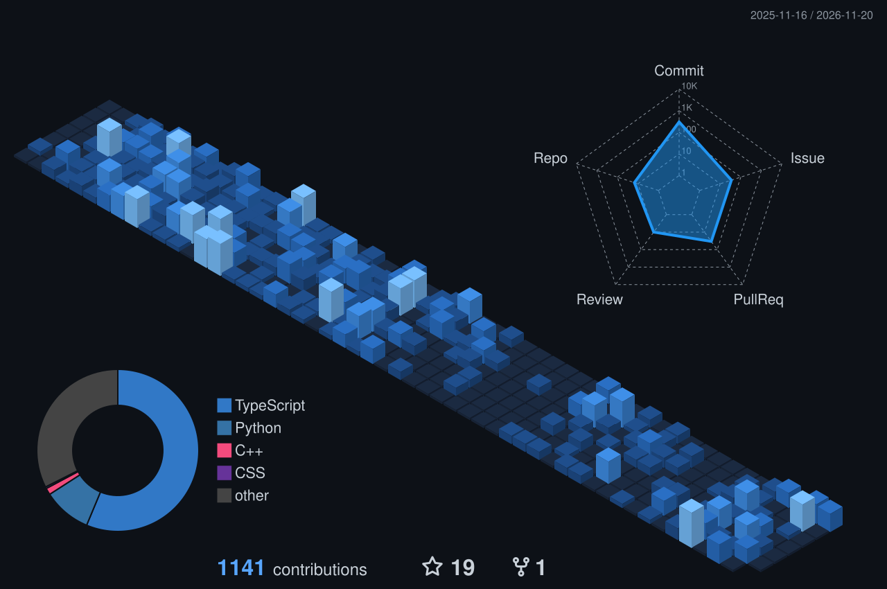
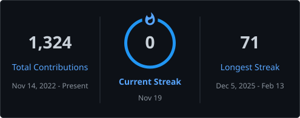

<h1>
    
</h1>

  
   

  

<h2>Technologies</h2>

<h2>GitHub Activity</h2>

  

  
  

  <picture>
    <source media="(prefers-color-scheme: dark)" srcset="https://raw.githubusercontent.com/denver2714/denver2714/output/github-contribution-grid-snake-dark.svg">
    <source media="(prefers-color-scheme: light)" srcset="https://raw.githubusercontent.com/denver2714/denver2714/output/github-contribution-grid-snake.svg">
    
  </picture>

